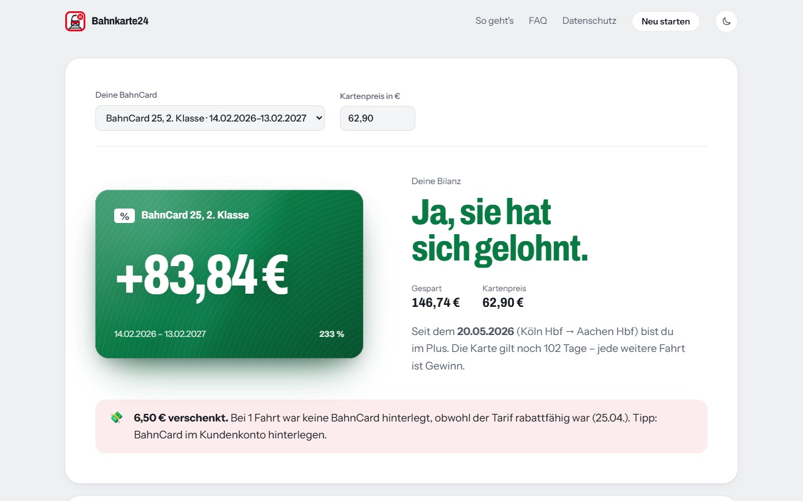
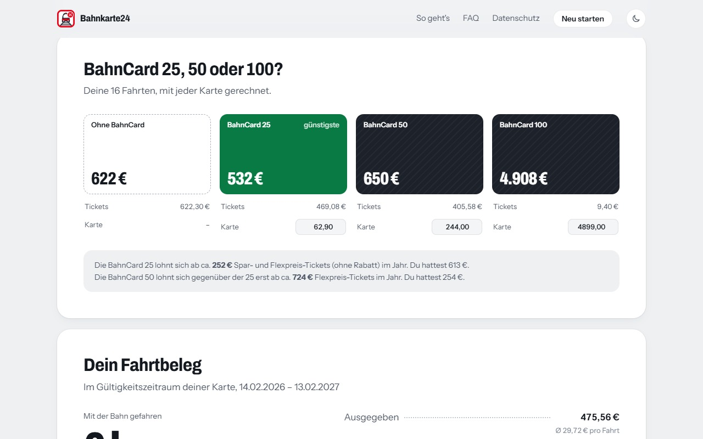

A BahnCard is Deutsche Bahn's discount card: you pay up front, then get 25, 50 or 100 % off your tickets for a year. Whether it actually paid off is surprisingly hard to answer. The numbers are spread across dozens of bookings in your bahn.de account, and nobody adds them up for you.

**Bahnkarte24** does. One click reads your real trips and answers the question in plain words.



## What you get

- **The verdict.** How much the card saved you in its validity period, and the exact trip where it paid for itself.
- **Forgotten discounts.** Trips where the card wasn't attached to the booking even though the fare was eligible.
- **25, 50 or 100?** The same trips priced without a card and with each BahnCard, so you can see which one would have been cheapest.
- **No card yet?** It works backwards too: would one have paid off with the trips you already took?
- **A trip receipt.** Kilometres, hours on the train, cents per kilometre, favourite route, most-used trains and spending per month.



## How it works

The project is two parts that talk to each other in the browser.

1. **The website** ([bahnkarte24.de](https://bahnkarte24.de/)) does all the maths and draws the results. It's static HTML, CSS and plain JavaScript, with no build step and no backend.
2. **The extension** (Chrome and Firefox, Manifest V3) fetches the data. Clicking its icon opens bahn.de in a new tab. Once you're signed in, a content script reads your BahnCards and past bookings through the same JSON endpoints bahn.de uses for its own "My trips" page. It strips the bookings down to fares, dates and routes, then hands them back to the website tab.

The extension only acts in the tab it opened itself and does nothing on any other bahn.de page. It never changes or books anything.

## The interesting bits

**Staying polite to bahn.de.** A long booking history means a lot of requests, and bahn.de answers with `429 Too Many Requests` when you go too fast. The collector starts in parallel without any delay. As soon as it gets throttled, it drops to a single worker with a pause that doubles up to 5 s. After a run of clean responses it speeds back up:

```js
if (r.ok) {
  pause = pause > 100 ? Math.round(pause * 0.85) : 0;
  if (++ruhig >= 8) gebremst = false; // eight calm answers → parallel again
  return r.json();
}
// 429 or 5xx: slow down
gebremst = true;
pause = Math.min(Math.max(pause * 2, 400), 5000);
```

**Short-lived tokens.** bahn.de rotates its access token during a session, which used to break long imports halfway through. Instead of a token, the collector takes a function that returns one, and reads the freshest token on every request. After a `401`, it waits up to a minute for bahn.de to store a new token before giving up.

**A service worker that can die.** Manifest V3 background scripts are stopped whenever the browser feels like it. The pairing between the bahn.de tab and the results tab therefore lives in `chrome.storage.session`, so a restart mid-import still delivers the data to the right place.

## Privacy by design

There is no server to send anything to. The website is static, the extension's only permission is `storage`, and it reads nothing beyond fares, dates and routes: no names, addresses or payment details. The results exist only in your browser tab, and the full source is on GitHub.

## Design

The look is meant to feel like a printed train ticket: calm, factual and clear, with no celebrating and no upselling. Colour has a fixed meaning. Green always means money saved, red means an action or a loss, and everything else is ink. The card's own number (25/50/100) flips on a split-flap board in the hero. On the results screen the BahnCard fills up as your savings approach its price.

---

Bahnkarte24 is an independent project and is not affiliated with Deutsche Bahn AG. "BahnCard" and "Deutsche Bahn" are trademarks of Deutsche Bahn AG.
