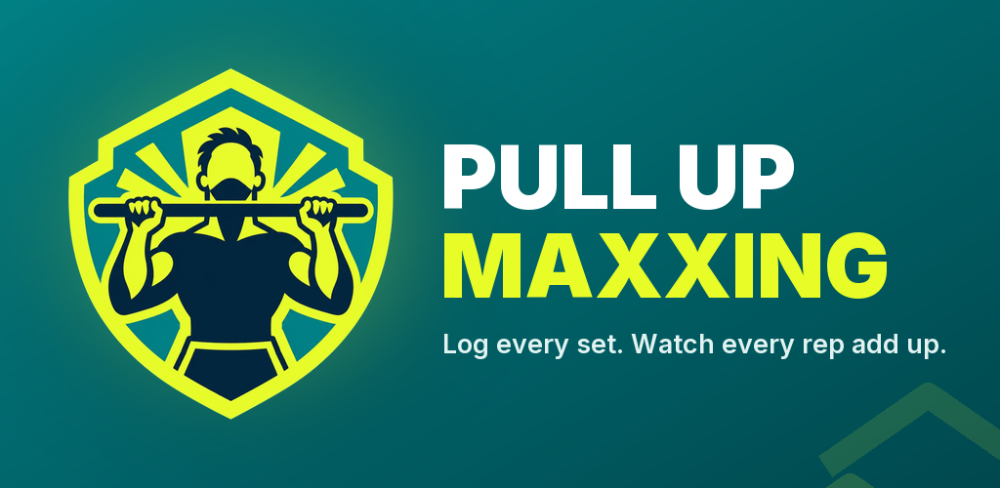

I was chasing my first 20 strict pull-ups, and every notes app I tried turned my training log into a mess. I kept forgetting what my last max was. So I built a log that does exactly one thing well.

## What it does

**Train.** Start today's planned workout with one tap. Log reps and added weight set by set; a rest timer buzzes when it's time for the next one. A hang timer with a 3-second countdown covers dead hangs, and every set shows what you did at the same set last time.

**Plan the week.** Workout types are Strength, Volume, EMOM, Reps, Negatives, Supported and Dead Hangs, or your own. Plan each day and swipe between weeks.

**Follow your progress.** Set one goal, like 100 pull-ups in one session or within 20 minutes, optionally with a deadline, and watch it fill up. There's a weekly chart, streaks, personal bests including the heaviest added weight, and your pace. On top of that come 35 milestones, from your first hundred reps to weighted pull-ups, each with gold tiers.

Assisted and hang work counts as training but never inflates your pull-up numbers. That rule sounds small, but it touches every statistic in the app.

## How it's built

The app is **Expo** with **React Native** and **Expo Router**, written in TypeScript.

The most useful decision was keeping the tracking logic platform-neutral. Goals, milestones, stats, streaks, pace, reminders and data migration all live in `src/shared`, with no React Native or DOM imports. That has three benefits:

- **Fast tests.** The logic is unit-tested with Vitest in plain Node, with no emulator involved.
- **It survived a rewrite.** The project started as a web app. When it moved to Android, the shared logic came along unchanged, and backups exported from the old web app still import.
- **Storage is a plug-in.** On the phone, data goes into `expo-sqlite`'s key-value store. In the browser preview, a `.web.ts` stand-in uses `localStorage` instead, so `npx expo start --web` works for quick UI checks.

Icons are named in the shared code (`AppIcon`) and mapped to `lucide-react-native` in one component, so the logic never depends on an icon library.

## Your data stays on your phone

There is no server and no account. Everything is stored on the device, and you can export and import a backup file at any time. The app comes in light and dark mode, in English and German.

## Status

Version 1.3.0 is in closed testing on Google Play. Google requires 12 testers over 14 days before an app can be released publicly, so that's the current step.
